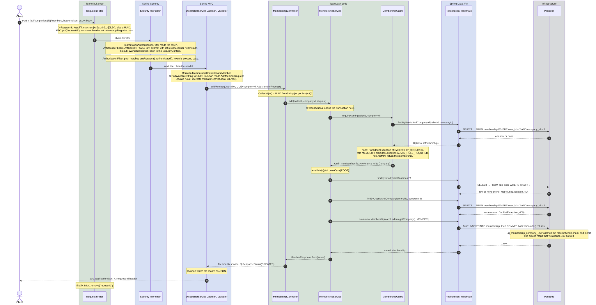
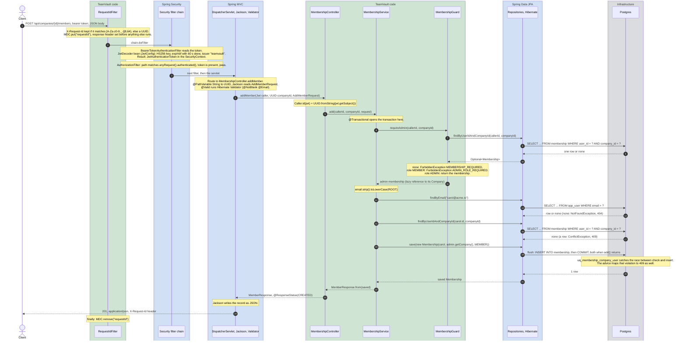

# Walkthrough 1: one secured request, end to end

The request: an admin adds a colleague to a company.

```http
POST /api/companies/{companyId}/members
Authorization: Bearer eyJ...
Content-Type: application/json

{"email": "Carol@Acme.io", "role": "MEMBER"}
```

The diagram follows that request from the socket to the `201` and back. Three lanes:
blue is Spring and its libraries doing work we only configured, green is code in this
repository, grey is infrastructure. The arrows are numbered; the narrative below groups
them into nine steps and names the arrows each step covers.



Full size: [open the raw SVG](01-secured-request-add-member.svg?raw=true), which fills the
window and zooms with the browser. GitHub's own file viewer only shows it scaled to fit.

<details>
<summary>Mermaid source (editable mirror of the diagram, re-render the SVG after a change)</summary>



</details>

Every exception named in the diagram leaves through the same exit, `ApiExceptionHandler`,
and becomes a Problem Details body with the request id. That path is
[walkthrough 2](02-errors-two-exits-one-shape.md). Where the token came from in the first
place is [walkthrough 3](03-credentials-and-the-token.md).

## What happens, step by step

1. **Request id first (arrows 1 and 2).** `RequestIdFilter` runs at highest precedence, before the security
   chain, so even a `401` carries an id. It keeps a well-formed client id and replaces
   anything else, puts the id into the logging context (MDC) and onto the response header.
   Everything logged during this request now carries `requestId=...`.
2. **Token check, by Spring (between 2 and 3).** The resource server filter pulls the bearer token out of the
   header and hands it to the `JwtDecoder` bean. Our part is `JwtConfig`: which key, which
   algorithm, which issuer. Spring's part is parsing, signature verification, expiry with clock
   skew and placing the result as the current `Authentication`. A missing or rejected token
   stops here and goes to the entry point (walkthrough 2).
3. **Authorization, by rules we wrote (arrow 3).** The chain compares the path against the matchers in
   `SecurityConfig`. The members path is not in any `permitAll` list, so
   `anyRequest().authenticated()` applies and an authenticated request passes. No role check
   happens here on purpose: roles live per company, not per user, so they are decided in the
   service (ADR-003).
4. **Routing, parsing, validation (arrow 4).** `DispatcherServlet` finds `addMember` by path and method.
   `{companyId}` is converted to a `UUID`, a bad value is a `400` from the advice. Jackson
   turns the JSON body into the `AddMemberRequest` record. `@Valid` runs the constraints on it
   before our method is called: a blank email never reaches the service.
5. **Who is calling (arrow 5).** `@AuthenticationPrincipal Jwt` injects the decoded token. `Caller.id`
   reads the `sub` claim, which `TokenService` set to the user's UUID at login. No database
   lookup is needed to know who calls; the signature proved it.
6. **The gate (arrows 6 to 11).** `MembershipService.add` opens a transaction and asks the guard first. The
   guard runs one query on `membership`. A non-member gets the neutral `403`, whether or not
   the company exists, so the error cannot be used to probe for company ids. A member without
   the ADMIN role gets the explicit `403`. The admin's membership holds a lazy reference to its
   `Company`; Hibernate sets the foreign key of the new row from that reference, so no second
   select on `company` runs.
7. **Find the colleague (arrows 12 to 14).** The email is normalised the same way registration stores it, so
   `Carol@Acme.io` finds the row written as `carol@acme.io`. An unknown email is a `404`,
   which an admin is allowed to learn (see the Javadoc on `add`).
8. **Duplicate check, twice (arrows 15 to 17).** The service checks for an existing membership and answers
   `409` with a readable message. Two admins adding the same person in the same instant can
   both pass that check; the unique constraint `uq_membership_company_user` then rejects the
   second insert at commit, Spring translates it to `DataIntegrityViolationException`, and the
   advice maps it to the same `409`. The check is for the message, the constraint is for
   correctness.
9. **Insert and commit (arrows 18 to 24).** `save` only queues the entity: the id comes from
   `@UuidGenerator` and `created_at` from `@CreationTimestamp`, both set in Java, so the
   column defaults in `V1__init.sql` never fire for rows written through JPA. The `INSERT`
   runs at flush, right before the commit, both when `add` returns. The controller maps the
   entity to `MemberResponse`, Spring writes JSON and sets `201` from `@ResponseStatus`.

## Who wrote what

| Step | Class or component | Written by us | Configured by us | Spring does it |
|---|---|---|---|---|
| 1 | `RequestIdFilter` | the filter | | registers it as a servlet filter |
| 2 | `BearerTokenAuthenticationFilter`, `NimbusJwtDecoder` | | `JwtConfig` (key, HS256, issuer) | extraction, verification, `SecurityContext` |
| 3 | `AuthorizationFilter` | | the matcher list in `SecurityConfig` | evaluation |
| 4 | `DispatcherServlet`, Jackson, Hibernate Validator | the record and its constraints | | routing, conversion, parsing, validation |
| 5 | `Caller`, `@AuthenticationPrincipal` | `Caller.id` | | argument injection |
| 6 | `MembershipGuard`, `MembershipRepository` | guard, the query method name | | the SQL behind the method name |
| 7 and 8 | `MembershipService`, `AppUserRepository` | the rules | | query derivation, `DataIntegrityViolationException` |
| 9 | `@Transactional`, Hibernate, Jackson | the entity mapping | | transaction, flush and `INSERT`, serialisation, status |

Of the nine steps, our code carries the decisions in 1, 5, 6, 7 and 8. In 2, 3, 4 and 9 we
wrote configuration or declarations and Spring did the work.

## Where to look

- `backend/src/main/java/.../common/RequestIdFilter.java`
- `backend/src/main/java/.../config/SecurityConfig.java` and `auth/JwtConfig.java`
- `backend/src/main/java/.../membership/MembershipController.java`, `MembershipService.java`,
  `MembershipGuard.java`, `MembershipRepository.java`, `AddMemberRequest.java`
- `backend/src/main/resources/db/migration/V1__init.sql` for `uq_membership_company_user`
- Tests at each rung: `MembershipGuardTest` and `MembershipServiceTest` (unit),
  `MembershipApiIntegrationTest` (full context against Postgres)

## What breaks if you remove it

- **`RequestIdFilter`:** responses lose the header, log lines lose their correlation key, and
  the Problem Details bodies lose `requestId`. Nothing else notices, which is why it is easy
  to forget and hard to debug without.
- **`anyRequest().authenticated()`:** Spring Security's default would still deny, but one
  `permitAll` too wide and the controller runs with a `null` principal and fails with a `500`
  in `Caller.id`. Deny by default is the rule, the explicit list is the documentation.
- **`@Valid`:** a blank email reaches the service, `strip()` works, `findByEmail("")` returns
  nothing, and the client gets a misleading `404` instead of a `400` naming the field.
- **The guard call:** any authenticated user could add members to any company. The
  cross-tenant negative tests exist for exactly this line.
- **The unique constraint:** the duplicate check still catches the sequential case, the
  concurrent case produces two rows, and `listMembers` shows the colleague twice.

## Questions this page answers

- Where does the `Jwt` parameter in the controller come from, and why is no user lookup
  needed to identify the caller?
- Why is a non-member answered with `403` and not `404`, and why does a member without the
  role get a different message?
- Why does the service check for a duplicate when the database already has a unique
  constraint?
- Which parts of this request are code in the repository and which are Spring behaviour that
  two lines of configuration switched on?
