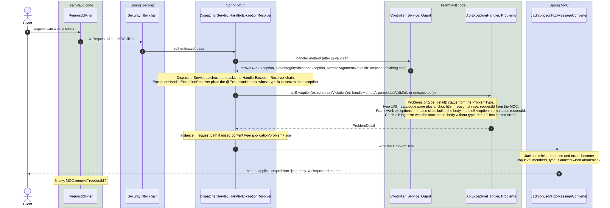
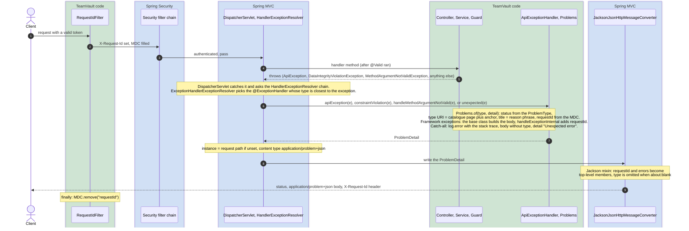
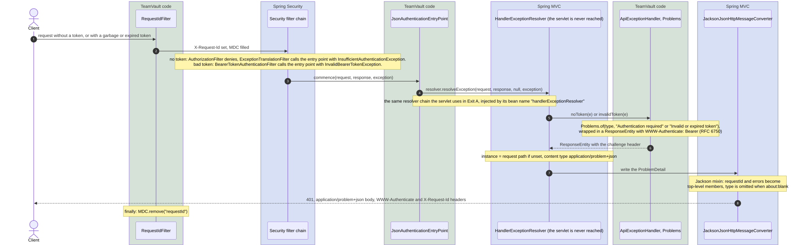
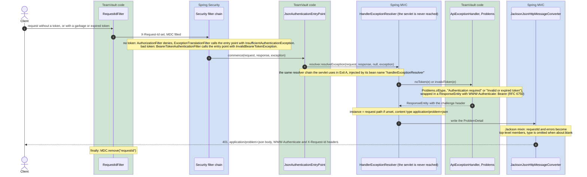

# Walkthrough 2: errors, two exits, one shape

Every error TeamVault sends looks the same:

```json
{
  "type": "https://github.com/luke-ken/teamvault/blob/main/docs/errors.md#membership-required",
  "title": "Forbidden",
  "status": 403,
  "detail": "Not a member of this company",
  "instance": "/api/companies/11111111-1111-1111-1111-111111111111/files",
  "requestId": "6f1c2a9e-5b7d-4c3e-9a1f-2d8e7b6c5a40"
}
```

The hard part is not building that body. It is that errors leave the application through
two different doors, and only one of them opens in any given request. Exit A is an exception
thrown inside Spring MVC: a controller, a service, the guard, or the validation that runs
before the handler. Exit B is a rejection in the security filter chain, which happens before
the `DispatcherServlet` is reached at all. Spring's defaults answer those two cases with two
different bodies. The two diagrams below show each exit from request to response, and how
both are routed into one class, `ApiExceptionHandler`, and from there through one serializer:
the last four arrows are the same in both. Lanes as in
[walkthrough 1](01-secured-request-add-member.md): green is code in this repository, blue is
Spring.

## Exit A: an exception inside Spring MVC



Full size: [open the raw SVG](https://raw.githubusercontent.com/luke-ken/teamvault/main/docs/walkthroughs/02-errors-two-exits-one-shape.svg).

<details>
<summary>Mermaid source (editable mirror of the diagram, re-render the SVG after a change)</summary>



</details>

## Exit B: a rejection in the security filter chain



Full size: [open the raw SVG](https://raw.githubusercontent.com/luke-ken/teamvault/main/docs/walkthroughs/02-errors-two-exits-one-shape-2.svg).

<details>
<summary>Mermaid source (editable mirror of the diagram, re-render the SVG after a change)</summary>



</details>

Where the token itself comes from is [walkthrough 3](03-credentials-and-the-token.md).

## What happens, step by step

1. **Exit A, the exception (A, arrows 1 to 5).** The request passed the chain, so the request id
   is in the MDC and the token is verified. Somewhere inside MVC an exception is thrown: our
   own `ApiException` subclasses from the service layer, `DataIntegrityViolationException`
   from a unique constraint, `MethodArgumentNotValidException` from `@Valid` before the method
   body runs, or anything unexpected.
2. **Resolution inside MVC (A, arrow 6).** `DispatcherServlet` catches the exception and walks its
   `HandlerExceptionResolver` chain. `ExceptionHandlerExceptionResolver` looks for an
   `@ExceptionHandler` method, first on the controller, then in every `@ControllerAdvice`, and
   picks the one whose declared type is closest to the thrown exception. That is why one
   `ApiException` handler covers every subclass, and why the `Exception` handler only sees
   what nothing else claimed.
3. **Exit B, the rejection (B, arrows 1 to 3).** Without a token the request is anonymous, the
   authorization filter denies it, and `ExceptionTranslationFilter` calls the configured entry
   point with an `InsufficientAuthenticationException`. With a token that fails to decode,
   the bearer token filter calls the same entry point with an `InvalidBearerTokenException`.
   Both entry point settings in `SecurityConfig` name our `JsonAuthenticationEntryPoint`.
   The controller, the service and the guard are never reached; the advice is, see step 4.
4. **The delegation (B, arrows 4 and 5).** Spring's default entry point writes an empty `401`
   itself. Ours does not write anything. It hands the exception to the
   `HandlerExceptionResolver` bean named `handlerExceptionResolver`, the composite the
   servlet uses in Exit A, which routes it to the advice as if it had been thrown by a
   controller. The qualifier matters: Boot also registers `DefaultErrorAttributes`, which
   implements the same interface and would resolve nothing.
5. **One body builder (A, arrow 7; B, arrow 6).** Every handler calls `Problems.of` with a
   `ProblemType` and a detail. The type carries the status and the catalogue anchor, the title
   is the status reason phrase, and `requestId` is read from the MDC that the filter filled.
   The two `401` handlers wrap the body in a `ResponseEntity` to add `WWW-Authenticate:
   Bearer`. Framework exceptions take a different route to the same place: the base class
   `ResponseEntityExceptionHandler` builds their `ProblemDetail`, and our override of
   `handleExceptionInternal` adds the request id to whatever body it built. The catch-all
   logs the stack trace and returns a body without `type`, so the client learns the status
   and nothing about the cause.
6. **Serialization (A, arrows 8 and 9; B, arrows 7 and 8).** Spring MVC sets `instance` to the request path when
   the handler left it empty and chooses `application/problem+json`. The Jackson converter
   carries a mixin for `ProblemDetail` that writes the `properties` map as top-level members,
   so `requestId` and `errors` sit next to `status`, and omits `type` when it is
   `about:blank`. The response passes back out through the request id filter, which clears
   the MDC.

## Trigger, exit, handler

| Trigger | Thrown where | Exit | Handler | Status, type |
|---|---|---|---|---|
| No `Authorization` header on a protected route | `ExceptionTranslationFilter` | B | `noToken` | `401 authentication-required`, challenge |
| Garbage, expired or wrong-issuer token | `BearerTokenAuthenticationFilter` | B | `invalidToken` | `401 invalid-token`, challenge |
| Wrong password or unknown email at login | `AuthService.login`, via the controller | A | `badCredentials` | `401 bad-credentials`, no challenge |
| Non-member reads a company | `MembershipGuard` | A | `apiException` | `403 membership-required` |
| Blank email in a body | argument resolution, before the method | A | `handleMethodArgumentNotValid` | `400 validation-failed` with `errors` |
| Broken JSON or an unknown `tier` | Jackson, during argument resolution | A | `handleHttpMessageNotReadable` | `400 malformed-body` |
| `/api/nope` | `NoResourceFoundException` in MVC | A | base class, decorated | `404`, no type |
| Anything else | anywhere inside MVC | A | `unexpected` | `500`, no type |

## Who wrote what

| Piece | Written by us | Configured by us | Spring does it |
|---|---|---|---|
| `RequestIdFilter`, MDC | the filter | | runs it first |
| Entry point wiring | `JsonAuthenticationEntryPoint` | two `authenticationEntryPoint` calls in `SecurityConfig` | detects the rejection, calls `commence` |
| Resolution to a handler | | | `HandlerExceptionResolver` chain, closest-type match |
| Body for our exceptions | `ApiExceptionHandler`, `Problems`, `ProblemType` | | |
| Body for framework exceptions | the `handleExceptionInternal` override | | `ResponseEntityExceptionHandler` builds `ProblemDetail` |
| `instance`, content type, JSON layout | | | MVC return value handling, the Jackson mixin |
| Error catalogue | `docs/errors.md` | | |

The only lines that make the two exits meet are the two `authenticationEntryPoint` calls
and the constructor of the entry point. Everything after that is shared.

## Where to look

- `backend/src/main/java/.../common/ApiExceptionHandler.java`, `Problems.java`,
  `ProblemType.java`, `ApiException.java` and its subclasses
- `backend/src/main/java/.../auth/JsonAuthenticationEntryPoint.java`
- `backend/src/main/java/.../config/SecurityConfig.java`, the two entry point lines
- `docs/errors.md` for the catalogue, [ADR-005](../adr/005-error-contract-problem-details.md)
  for the decision
- Tests: `ApiExceptionHandlerTest` (slice: the mapping and that a secret in an exception
  message never reaches the body), `ErrorContractApiIntegrationTest` (full context: both
  exits, the challenge header, the request id in header and body)

## What breaks if you remove it

- **The `@Qualifier` on the entry point constructor:** Spring finds two beans of the type,
  the MVC composite and Boot's `DefaultErrorAttributes`, and refuses to start. Picking the
  wrong one by hand would start, and every `401` would go out with an empty body, because
  `DefaultErrorAttributes` records the exception and resolves nothing.
- **One of the two `authenticationEntryPoint` calls:** the exit it covered falls back to
  Spring's default, an empty `401` with the challenge header but no JSON and no request id.
  The integration test for that case fails on the content type.
- **The `handleExceptionInternal` override:** validation errors and `404`s keep their
  Problem Details body but lose `requestId`, the one field support needs.
- **The catch-all `Exception` handler:** an unexpected exception falls through to Boot's
  `/error` handling, a different JSON shape without `type` and `requestId`.
- **The entry point delegation itself, writing JSON in `commence` instead:** two places
  know the body shape, and the Jackson mixin that flattens the properties is not applied,
  because it lives in the MVC converter, not in the plain `ObjectMapper`.

## Questions this page answers

- Why does a missing token produce the same body shape as a validation error, when one
  happens in a filter and the other in a controller?
- Why does the entry point delegate to a resolver instead of writing the response?
- Which `@ExceptionHandler` runs when a `ForbiddenException` is thrown, and why does the
  `Exception` handler not catch it first?
- Where do `instance`, the content type and the flat `requestId` member come from, if no
  handler sets them?
