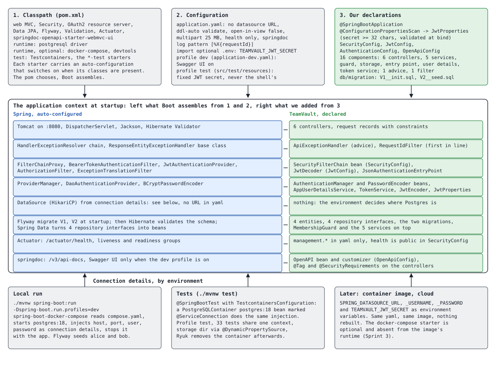

# Walkthrough 4: startup and wiring

The first three walkthroughs follow a request. This one looks at the application before
any request arrives: what exists in the context after `./mvnw spring-boot:run`, where each
piece came from, and how the same application finds its database in three different
environments without a connection URL in any file.

The picture reads top to bottom. Three inputs: the classpath the pom chose, the
configuration files, and the classes and migrations we wrote. The frame in the middle is
the result, one row per concern, Spring's assembled piece on the left and what we
contributed on the right. The bottom row is the one row that has no answer in the repo,
the database connection, resolved per environment.

Full size: [open the raw SVG](https://raw.githubusercontent.com/luke-ken/teamvault/main/docs/walkthroughs/04-startup-and-wiring.svg).
This diagram is hand-drawn SVG, like the ERD; there is no Mermaid source.

## What happens, in order

1. **The classpath decides what is possible.** Each starter in the pom carries an
   auto-configuration that activates when its classes are present and no bean of ours
   takes its place. Spring Web MVC gives Tomcat, the `DispatcherServlet`, Jackson and the
   validator. Spring Security gives the filter chain machinery. Data JPA gives Hibernate and
   the repository proxies. Flyway, Actuator and springdoc each add their piece. The
   docker-compose and devtools starters are optional runtime dependencies: present in a
   local run, absent from a packaged image.
2. **Configuration is read, then bound.** `application.yaml` is loaded, the optional `.env`
   next to the pom is imported for the signing secret, and the active profile adds its
   file: `dev` turns Swagger UI on, `test` (in the test resources) fixes the signing secret
   so the suite never depends on a developer's shell. `@ConfigurationPropertiesScan` finds
   `JwtProperties`; binding validates it, and a missing or short `TEAMVAULT_JWT_SECRET`
   stops the application here, before anything can sign a token.
3. **Our beans are registered.** Component scanning from the application class picks up
   the four configuration classes, six controllers, five services, the guard, the storage,
   the entry point, the user details service, the token service, the advice and the filter.
   Where one of our `@Bean` methods produces a type Spring would otherwise auto-configure,
   ours wins: the `SecurityFilterChain`, the `PasswordEncoder`, the `AuthenticationManager`,
   the `JwtEncoder` and `JwtDecoder`, the `OpenAPI` document.
4. **The database is found, not configured.** There is no datasource URL in the yaml, on
   purpose (ADR-001). Locally the docker-compose starter reads `compose.yaml`, starts
   `postgres:18`, and injects host, port, user and password as connection details. In the
   tests, `TestcontainersConfiguration` declares a `PostgreSQLContainer` bean marked
   `@ServiceConnection`, which injects the same details from a throwaway container. In a
   deployed environment the standard `SPRING_DATASOURCE_*` variables will do it. The
   `DataSource` and its Hikari pool are built from whichever source answered.
5. **Flyway runs before Hibernate looks.** Boot orders the Flyway migration ahead of the
   `EntityManagerFactory`, so `V1__init.sql` creates the tables and `V2__seed.sql` inserts
   the two demo users and companies, and only then does Hibernate validate that the four
   entity classes match the schema (`ddl-auto: validate`). Spring Data then turns the four
   repository interfaces into beans; the SQL behind `findByUserIdAndCompanyId` is derived
   from the method name at this moment.
6. **The security chain is built from our bean.** `SecurityConfig` returns a
   `SecurityFilterChain`; Spring Security turns it into the `FilterChainProxy` with the
   bearer token filter, the authorization filter and the exception translation filter, and
   wires our entry point into both places that can reject a request. Our
   `RequestIdFilter` is registered as a plain servlet filter at highest precedence, ahead of
   that proxy.
7. **Tomcat listens.** Port 8080, health probes answering at `/actuator/health`, the
   OpenAPI document at `/v3/api-docs`, Swagger UI only if the `dev` profile is active. From
   here on, walkthrough 1 applies.

## Who wrote what

| Concern | Written by us | Configured by us | Spring does it |
|---|---|---|---|
| Web layer | controllers, request records | `multipart` limits | Tomcat, dispatcher, Jackson, validation |
| Errors | advice, filter | | resolver chain, base handler class |
| Security chain | entry point, `JwtConfig` | the `SecurityFilterChain` bean | proxy, filters, providers |
| Credentials | `AppUserDetailsService`, `TokenService` | encoder and manager beans, `JwtProperties` | bcrypt, HMAC, binding and validation |
| Database | entities, repositories, migrations | `ddl-auto: validate`, `open-in-view: false` | pool, Flyway run, schema check, query derivation |
| Connection | | `compose.yaml`, `TestcontainersConfiguration` | connection details injection |
| Operations | | `management.*`, `springdoc.*`, log pattern | health groups, document generation |

Of the eight rows in the picture, two have nothing of ours on the right beyond yaml, and
one, the connection, has nothing of ours at all. That is the trade Boot offers: accept
the assembled defaults, override by declaring a bean of the same type, and keep your own
code to the decisions.

## Where to look

- `backend/pom.xml` for the starters and their scopes
- `backend/src/main/resources/application.yaml`, `application-dev.yaml`,
  `backend/src/test/resources/application-test.yaml`, `backend/.env.example`
- `backend/src/main/java/.../TeamvaultBackendApplication.java` and the four configuration
  classes: `config/SecurityConfig.java`, `config/OpenApiConfig.java`, `auth/JwtConfig.java`,
  `auth/AuthenticationConfig.java`, plus `auth/JwtProperties.java`
- `backend/compose.yaml`, `backend/src/test/java/.../TestcontainersConfiguration.java`,
  `AbstractIntegrationTest.java`
- `backend/src/main/resources/db/migration/`
- ADRs: [001](../adr/001-dev-db-via-docker-compose-and-testcontainers.md) for the
  database per environment, [002](../adr/002-spring-security-from-day-one.md) for the
  chain, [004](../adr/004-self-issued-jwt-auth.md) for the key

## What breaks if you remove it

- **`@ConfigurationPropertiesScan`:** `JwtProperties` is never bound, `JwtConfig` has no
  bean to inject, and the context fails on a missing dependency instead of on a clear
  "secret must be set" message.
- **The empty default in `secret: ${TEAMVAULT_JWT_SECRET:}`:** an unset variable becomes an
  unresolvable placeholder, which also stops startup, but with a placeholder error instead
  of the validation message that names the variable.
- **`ddl-auto: validate`:** a migration that forgets a column goes unnoticed until the
  first query fails at runtime. With it, the mismatch stops startup.
- **`open-in-view: false`:** every request holds a database connection for its whole
  duration, and lazy loading silently works from controllers, hiding N+1 queries. Boot
  warns about this default for a reason.
- **The docker-compose starter:** a local run has no connection details and fails to
  start, unless the developer starts Postgres and sets the variables by hand. The tests
  are unaffected, they bring their own container.
- **`@ServiceConnection` on the test container bean:** the container starts but nothing
  reads its port; the tests need a `@DynamicPropertySource` for the URL instead, which is
  the older, longer way to the same result.

## Questions this page answers

- Where does the `DataSource` get its URL, given that no file in the repository contains
  one?
- What runs first at startup, Flyway or Hibernate, and why does the order matter?
- Which of the beans in this application are ours, which are Boot's, and how does Boot
  decide to step back?
- Why does the suite not need the developer's signing secret, and why does a local run
  stop when the secret is missing?
