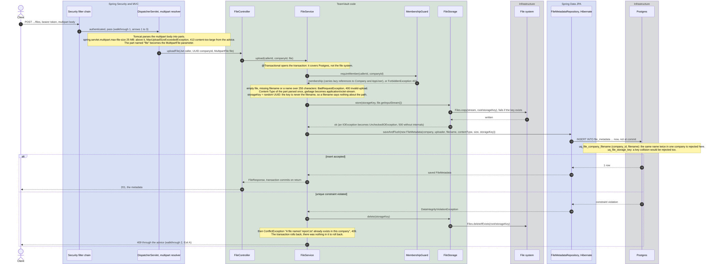
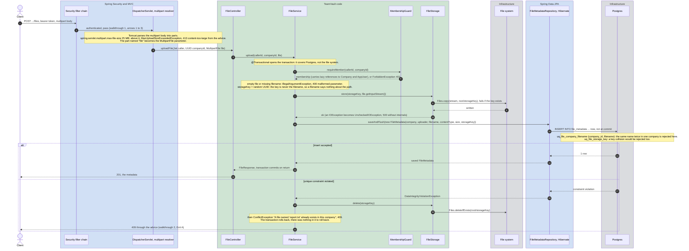
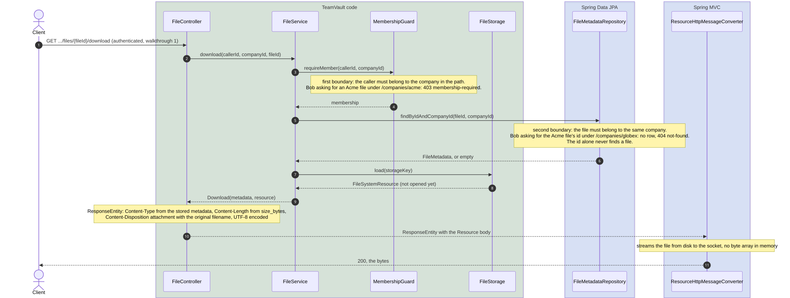
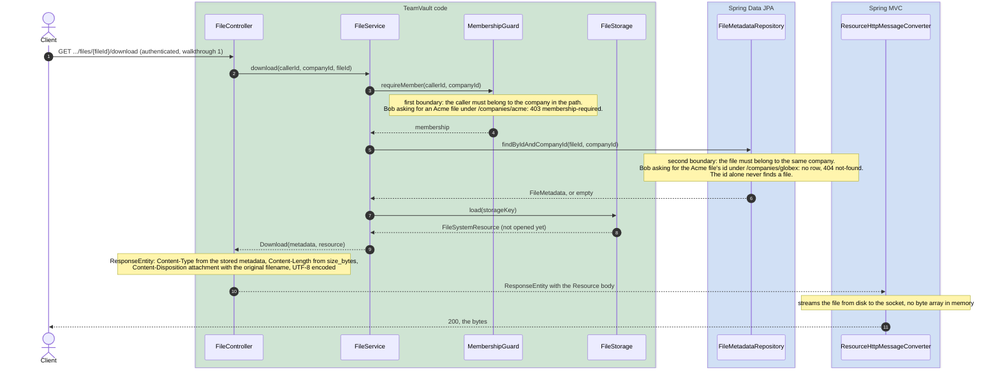

# Walkthrough 5: upload with compensation, download within the tenant

A file upload writes to two places that cannot share a transaction: the blob goes to the
file system, the metadata row goes to Postgres. The page shows how the service keeps the
two consistent without distributed transactions, and how the download path enforces the
tenant boundary a second time. Lanes as in [walkthrough 1](01-secured-request-add-member.md):
green is code in this repository, blue is Spring, grey is infrastructure.

## A: upload, blob first, row second, blob removed if the row fails

```http
POST /api/companies/{companyId}/files
Authorization: Bearer eyJ...
Content-Type: multipart/form-data; boundary=...

--... name="file"; filename="report.txt"
```



Full size: [open the raw SVG](https://raw.githubusercontent.com/luke-ken/teamvault/main/docs/walkthroughs/05-upload-with-compensation.svg).

<details>
<summary>Mermaid source (editable mirror of the diagram, re-render the SVG after a change)</summary>



</details>

## B: download, the tenant boundary checked twice

```http
GET /api/companies/{companyId}/files/{fileId}/download
Authorization: Bearer eyJ...
```



Full size: [open the raw SVG](https://raw.githubusercontent.com/luke-ken/teamvault/main/docs/walkthroughs/05-upload-with-compensation-2.svg).

<details>
<summary>Mermaid source (editable mirror of the diagram, re-render the SVG after a change)</summary>



</details>

## What happens, step by step

1. **Multipart arrives (A, arrows 1 to 4).** Tomcat parses the body into parts and Spring
   hands the part named `file` to the controller as a `MultipartFile`. The 25 MB limit in
   `application.yaml` is enforced before the controller runs; above it, the advice answers
   `413` with the catalogue type `content-too-large`.
2. **Scope first, then sanity (A, arrows 5 and 6).** The guard runs before anything is
   written. Then the service rejects an empty part or a missing filename with `400`. The
   storage key is a fresh UUID, never derived from the filename, so a crafted filename
   cannot steer where the blob lands.
3. **Blob before row (A, arrows 7 to 10).** The bytes are copied to the storage directory
   under the key. The file system is outside the transaction, so if this fails the method
   throws and no row was attempted: nothing to clean up.
4. **Row with an immediate flush (A, arrows 11 and 12).** `saveAndFlush` sends the `INSERT`
   now instead of at commit. That is the whole trick: the unique constraint on
   `(company_id, filename)` fires inside the method, where the storage key is still in
   hand. A plain `save` would surface the violation at commit, after the method returned,
   with no code left to delete the blob.
5. **Two endings (A, from arrow 13).** Accepted: the metadata is returned and the
   transaction commits. Rejected: the service deletes the blob it wrote, then throws the
   conflict, which the advice turns into `409` with the filename in the detail. The
   remaining gap is a crash between the blob write and the commit, which leaves an orphan
   blob and no row: harmless, and a cleanup job for a later ladder row.
6. **Download checks the tenant twice (B, arrows 3 to 6).** The guard checks that the
   caller belongs to the company in the path. The query then looks the file up by id and
   company together, so a file id from another company finds nothing and answers `404`.
   The cross-tenant test drives both: `403` when Bob uses Acme's path, `404` when Bob uses
   Acme's file id under his own company.
7. **Streaming out (B, arrows 7 to 11).** The storage returns a `Resource` that is not
   opened yet. The controller sets the content type and length from the stored metadata and
   a `Content-Disposition` with the original filename. Spring's resource converter streams
   the file to the socket; the bytes never sit in a Java array.

## Who wrote what

| Piece | Written by us | Configured by us | Spring does it |
|---|---|---|---|
| Multipart parsing | the `@RequestParam("file") MultipartFile` parameter | `max-file-size`, `max-request-size` | Tomcat parsing, size limits, `413` exception |
| Scope | `MembershipGuard`, the query by id and company | | query derivation |
| Blob store | `FileStorage` (store, load, delete) | `teamvault.storage.dir` | `FileSystemResource` |
| Consistency | blob-then-row order, `saveAndFlush`, the compensation | | flush, constraint translation to `DataIntegrityViolationException` |
| Download headers | the `ResponseEntity` in the controller | | `ContentDisposition` builder, resource streaming |

The consistency logic is nine lines in `FileService.upload`: one call order, one flush, one
catch block. Everything else on the page is Spring behaviour we switched on.

## Where to look

- `backend/src/main/java/.../file/FileService.java`, `FileStorage.java`,
  `FileController.java`, `FileMetadata.java`, `FileMetadataRepository.java`
- `backend/src/main/resources/application.yaml` for the multipart limits and the storage
  directory, `db/migration/V1__init.sql` for `uq_file_company_filename` and
  `uq_file_storage_key`
- `docs/production-readiness.md`, "Data and storage": the local file system is the one
  blocker for a second instance, the S3-compatible store is the Sprint 3 swap behind the
  same `FileStorage` interface
- Tests: `FileApiIntegrationTest` (round trip, cross-tenant `403` and `404`, duplicate
  filename `409`, `401` without credentials)

## What breaks if you remove it

- **`saveAndFlush`, using `save`:** the duplicate is still rejected, at commit, but the
  blob stays on disk under a key no row references. The `409` test still passes, the
  orphan goes unnoticed.
- **The blob-then-row order, writing the row first:** a failing blob write rolls the row
  back, which is fine, but the constraint violation now happens before any blob exists and
  the compensation code runs `delete` on a key that was never written. Harmless here,
  misleading to read, and the first storage backend with a cost per delete pays for it.
- **The storage key as UUID, using the filename:** two companies uploading `report.txt`
  collide on disk, and a filename like `../../etc/passwd` becomes a path question.
- **`findByIdAndCompanyId`, using `findById`:** the guard still blocks non-members of the
  path's company, but a member of Globex could fetch an Acme file by guessing or learning
  its id under the Globex path. The second boundary is what the cross-tenant test asserts.
- **`produces = MediaType.ALL_VALUE` on the download:** nothing breaks at runtime; the
  OpenAPI document claims the download returns JSON, and a generated client decodes a PDF
  as JSON.

## Questions this page answers

- How does the upload stay consistent across the file system and the database without a
  distributed transaction?
- Why `saveAndFlush` here and `save` everywhere else?
- Why is the storage key a UUID and not the filename?
- Where is the tenant boundary enforced on a download, and why twice?
